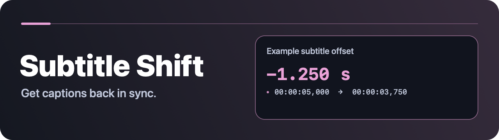

<p align="center">
  
</p>

# Subtitle Shift

Fix captions that are early or late, or turn an existing subtitle file into captions for a short clip.

## At a glance

| Task | How |
| --- | --- |
| **Sync a subtitle file** | Use `--offset` to move cues earlier or later. |
| **Make captions for a clip** | Use `--from` and `--to` to trim and reset timestamps to zero. |
| **Save the result** | Use `-o` to write a new SRT file, or omit it to print to stdout. |

## Quick start

```sh
python3 subtitle_shift.py captions.srt --offset=-1.250 -o synced.srt
python3 subtitle_shift.py captions.srt --from 34.5 --to 52 -o clip.srt
```

Requires Python 3.8+. Time arguments are seconds, precise to milliseconds. The offset applies first, then cues are clipped to the chosen range and rebased to zero. The script renumbers cues and preserves multiline caption text and optional position settings. It reads UTF-8 SubRip files, including files with a UTF-8 BOM. Without `-o`, it writes to standard output. With `-o`, it creates a new file and refuses to overwrite an existing one.

[MIT license](LICENSE)

## Shift and trim a clip

```sh
python3 subtitle_shift.py original.srt --offset -0.250 --from 10 --to 20 -o clip.srt
```

Trimming applies to the shifted timestamps. The range starts at 10 seconds and
is rebased to zero in the output. A cue that overlaps the range is clipped to
fit, and its subtitle text and timing settings are preserved.

Run the regression tests with `python3 -m unittest discover -s tests -v`.
